# Technical Design Document

| **Project Title**    | QA Copilot — Browser Extension (Evidence-Rich Bug Capture) |
| -------------------- | ---------------------------------------------------------- |
| **Document Version** | 1.2                                                        |
| **Date**             | August 12, 2026                                            |
| **Prepared By**      | Iffah Muzaffar                                             |
| **Reviewed By**      | \[Name(s)\]                                                |

# Revision History

| **Version** | **Date**        | **Author**     | **Description of Change** |
| ----------- | --------------- | -------------- | ------------------------- |
| 1.0         | August 10, 2026 | Iffah Muzaffar | Initial draft             |
| 1.1         | August 10, 2026 | Iffah Muzaffar | Spec-review fixes: added README deliverable; Teams payload/routing + Graph-vs-webhook note; status-lifecycle fix; RAG and cost-guardrail clarifications; data-source disambiguation; numbered repro steps; explicit HTTP highlight codes; delivery-plan appendix |
| 1.2         | August 12, 2026 | Iffah Muzaffar | Implementation sync: corrected draft shape (bug type / expected / observations); documented house-style prompt (`v2`); added evidence trimming before the LLM call; documented the four-section HTML `ReproSteps` document, the ADO field set, and the corrected attachment policy; Teams payload updated |

# Table of Contents

- [Purpose](#purpose)
- [Scope](#scope)
- [Data Design](#data-design)
- [API Design](#api-design)
- [Extension & Collector Design](#extension--collector-design)
- [AI Report Generation](#ai-report-generation)
- [Ralph Loop Runner](#ralph-loop-runner)
- [Error Handling](#error-handling)
- [Conclusion](#conclusion)
- [Appendix](#appendix)

# Purpose

Manual bug reporting is slow and lossy. A tester finds a defect, then spends minutes assembling a screenshot, remembering the exact steps, digging console errors out of dev tools, and copying network failures — and still the developer often replies "cannot reproduce, need more info." The evidence that would have settled it existed at the moment of failure and is now gone. The result is repeated QA↔dev round-trips and eroded trust in the report.

This design introduces a Manifest V3 browser extension that silently records a rolling buffer of everything that matters from the moment QA opens the target application — session context, user actions, console output, network traffic, screenshots, a short video, and environment state. When the tester triggers **Capture Bug** (button or `Ctrl+Shift+B`), the extension freezes the session, redacts secrets and PII **in the browser**, and ships the evidence package to a local .NET 8 backend. The backend invokes **Claude CLI** as a local subprocess behind an `ILlmProvider` interface to draft a structured, editable bug report, and — on explicit human confirmation — files a developer-ready **Azure DevOps** bug into the **TargetDMS** project with all attachments and posts an optional **Microsoft Teams** notification via a Power Automate incoming webhook. PostgreSQL runs as a Docker container; the backend runs on the host so it can call the Claude CLI subprocess directly. The build itself is driven by an autonomous **ralph loop** runner against `prd.md`.

# Scope

**In Scope:** MV3 extension collectors (session, user actions, console, network HAR, screenshot, rolling video buffer, environment); the capture/freeze flow; client-side redaction; evidence-package upload; a single .NET 8 (ASP.NET Core) backend for intake, AI orchestration, and integrations; Claude CLI report generation behind an `ILlmProvider` interface; the React + MUI review-before-file UI; Azure DevOps Bug creation with attachments into TargetDMS; optional Teams webhook notification (via Power Automate incoming webhook); local bring-up with PostgreSQL in Docker and the backend running on the host via `dotnet run`; the ralph loop runner that drives the build against `prd.md`; and a **README & Architecture Doc** covering local install/run of the extension and backend, ADO and Teams credential configuration, the collector/architecture map, the redaction/privacy approach, known limitations, and next steps (spec §6 #6).

**Out of Scope (this build):** duplicate-bug detection via pgvector, AI root-cause suggestions, and the session-timeline view (all designed-for but deferred per spec §4.7); scroll-and-stitch full-page screenshots (viewport + single full-page capture only); external object storage (local volume only); splitting the backend into separate intake/integration services; and non-Chromium browsers.

## Architecture Overview

```mermaid
flowchart TB
  subgraph Browser["BROWSER — target app (TargetDMS test env)"]
    direction TB
    DBG["chrome.debugger / CDP<br/>console · network (HAR)"]
    CS["Content Script<br/>user actions · field masking"]
    OFF["Offscreen Document<br/>MediaRecorder rolling buffer · CDP subs"]
    SW["Background Service Worker<br/>orchestrate · trigger · assemble"]
    RED["Redaction Pipeline (client-side)<br/>mask fields · filter cookies · strip payloads"]
    REVIEW["Review UI — React + MUI<br/>edit draft · human confirm"]
    DBG --> OFF
    CS --> SW
    OFF --> SW
    SW --> RED
  end

  subgraph Backend[".NET 8 BACKEND — docker-compose (local)"]
    direction TB
    INTAKE["Evidence Intake API<br/>POST /api/evidence"]
    AI["AI Analysis · ILlmProvider<br/>POST /api/reports/{id}/generate"]
    FILE["ADO Integration<br/>POST /api/reports/{id}/file"]
    TEAMS["Teams Notifier · INotifier"]
    PG[("PostgreSQL + pgvector<br/>report metadata / index")]
    VOL[("Evidence Volume<br/>video · HAR · screenshots")]
    INTAKE --> PG
    INTAKE --> VOL
    INTAKE --> AI
    FILE --> TEAMS
  end

  CLAUDE["Claude CLI<br/>host subprocess"]
  ADOSVC["Azure DevOps — TargetDMS<br/>Work Items + attachments"]
  MSTEAMS["Microsoft Teams<br/>incoming webhook"]

  RED -->|"&#9312; freeze + redact, upload package"| INTAKE
  AI -->|"&#9313; grounded prompt / draft"| CLAUDE
  CLAUDE -.->|structured draft| AI
  AI -->|"&#9314; draft to review"| REVIEW
  REVIEW -->|"&#9315; edited report, confirmed"| FILE
  FILE -->|"&#9316; create Bug + HTML repro doc + attachments"| ADOSVC
  TEAMS -->|"&#9317; optional notify"| MSTEAMS
```

*Flow: ① the extension freezes the session, redacts client-side, and uploads the evidence package; the backend stores it (Postgres metadata + volume blobs). ② Claude CLI drafts a grounded report. ③ the draft is shown in the review UI; ④ QA edits and confirms; ⑤ the ADO Bug is created in TargetDMS with the composed HTML repro document and the HAR/video/environment/session attachments; ⑥ an optional Teams notification fires. Steps ③–⑤ are the human-in-the-loop gate — nothing is filed or notified without it.*

| Component                     | Role                                                                                                                                                                                             |
| ----------------------------- | ------------------------------------------------------------------------------------------------------------------------------------------------------------------------------------------------ |
| **Background Service Worker** | Orchestrates collectors; owns the recording lifecycle (Start/Stop Recording, red/green gear icon, REC badge); owns the capture trigger (`Ctrl+Shift+B` / popup); assembles and uploads the evidence package. Recording state persisted in `chrome.storage.session` to survive evictions. |
| **Content Script**            | Two scripts injected into the target page. `UserActionCollector` observes DOM interactions (clicks, input, dropdowns, navigation) and emits human-readable action events; masks sensitive fields at the source. `SilentIssueNotifier` listens for error signals from the background and renders a dismissible toast with a one-click Capture Issue path. Both include double-injection guards so re-injection at recording start is idempotent. |
| **Offscreen Document**        | Hosts `MediaRecorder` and the rolling 3-min video buffer, plus the CDP subscriptions, so recording survives service-worker eviction (service workers are killed aggressively in MV3).            |
| **Collectors**                | Session, user-action, console, network (HAR), screenshot, video-buffer, and environment collectors. Console + network are sourced from `chrome.debugger` (CDP); the rest from extension/DOM APIs. |
| **Redaction Pipeline (client)** | Runs before anything leaves the browser: masks passwords/tokens/PII fields, filters cookies, and strips configured payload bodies. Trust boundary of the system.                                |
| **Backend API (.NET 8)**      | Single ASP.NET Core service. Receives the evidence package, persists it, orchestrates AI analysis, and drives the ADO and Teams integrations.                                                     |
| **AI Analysis (`ILlmProvider`)** | Invokes Claude CLI as a local subprocess to turn the evidence package into a structured bug report. Grounded strictly in the supplied evidence, and the evidence is trimmed to the signal-bearing subset before the prompt is built.                                                |
| **ADO Integration**           | Creates a Bug work item in TargetDMS via the ADO REST API. Composes the `ReproSteps` field as a single HTML document (Repro Steps + observations, System Details table, Network table, embedded screenshot). `environment` is the only `AttachedFile` relation; the screenshot is uploaded for its ADO URL but embedded inline rather than attached, and the remaining evidence files are not uploaded because the document already renders them. |
| **Teams Notifier (`INotifier`)** | Posts an optional "new bug submitted" notification (bug type, module, severity, and assigned/responsible team, plus expected state and observations) on confirmed submit. Uses a Teams **incoming webhook** — a deliberate demo substitute for Microsoft Graph — which posts to one fixed channel; per-team channel routing is a noted limitation.                                                                                                 |
| **PostgreSQL (Docker)**       | Stores report/session metadata and the evidence index. Single datastore; pgvector present on the same instance for future dedup (unused this build).                                              |
| **Evidence Volume**           | `docker-compose` volume holding video/HAR/screenshot blobs, referenced from Postgres metadata and the ADO ticket.                                                                                 |

## Data & Processing Flow

- **Step 1.** QA clicks **Start Recording** in the extension popup → the background worker attaches the Chrome debugger to the active tab, re-injects content scripts, and activates all collectors. The icon turns green with a "REC" badge. Collectors run silently from this point; the video/evidence buffer rolls (last 3 minutes retained).
- **Step 2.** QA triggers **Capture Bug** (button or `Ctrl+Shift+B`) — only works while recording is active → the background worker freezes the session and snapshots all collectors + the buffer window.
- **Step 3.** Sensitive fields, cookies, and PII are masked/redacted client-side; the evidence package is uploaded to the backend intake endpoint.
- **Step 4.** The backend trims the stored evidence to the signal-bearing subset and runs Claude CLI to produce a structured, editable bug report (title, bug type, repro steps, expected, observations, suspected module, severity, priority).
- **Step 5.** QA reviews/edits the draft; on confirm, the backend creates the ADO bug — one composed HTML `ReproSteps` document plus the HAR, video, environment, and session attachments — and (optionally) posts the Teams notification.
- **Step 6.** Evidence is stored on the volume and indexed in Postgres for the demo and future enhancements.

# Data Design

## Evidence Package (client → backend intake)

| Field              | Type   | Description                                                                                     |
| ------------------ | ------ | ----------------------------------------------------------------------------------------------- |
| capture_id         | UUID   | Client-generated idempotency key for this capture                                               |
| captured_at        | string | ISO-8601 timestamp of the freeze                                                                |
| session            | object | URL, navigation history, browser/version, OS, resolution, viewport, time-on-page, current module |
| environment        | object | Language, timezone, local/session storage (redacted), filtered cookies, feature flags, roles    |
| actions            | array  | Ordered, numbered, human-readable interaction events (sensitive input masked) → repro steps               |
| console            | array  | Errors/warnings/exceptions/rejections with timestamp, stack, source file, line                  |
| network            | object | HAR document; failed requests flagged (400/401/403/404/409/422/500); payloads per capture policy                     |
| screenshot         | ref    | Volume reference to viewport and/or full-page image                                             |
| video              | ref    | Volume reference to the trimmed pre-capture buffer window                                       |
| redaction_report   | object | What was masked/removed (for reviewer trust; no secret values)                                  |

The `session`, `environment`, `actions`, `console`, and `redaction_report` fields travel inline in the JSON package (small, text) and are the source of truth. Only `screenshot`, `video`, and the HAR are uploaded as blobs and stored on the volume, with the JSON carrying references rather than bytes. The `console.json` and `environment.json` files on the volume are serialized copies of the inline JSON, written so the generate and filing steps can read them back; of the two, only `environment.json` is attached to the ADO bug.

## `bug_reports` Table — PostgreSQL

| Column            | Type         | Description                                             |
| ----------------- | ------------ | ------------------------------------------------------- |
| id                | BIGSERIAL PK | Auto-incrementing primary key                           |
| capture_id        | UUID         | Idempotency key from the client; UNIQUE                 |
| created_at        | TIMESTAMPTZ  | Intake timestamp                                        |
| updated_at        | TIMESTAMPTZ  | Last status change                                      |
| status            | VARCHAR(20)  | RECEIVED / DRAFTED / EDITED / FILED / FAILED            |
| target_url        | TEXT         | URL captured (TargetDMS test env)                       |
| module            | VARCHAR(255) | Suspected impacted module                               |
| severity          | VARCHAR(20)  | Suggested severity                                      |
| priority          | VARCHAR(20)  | Suggested priority                                      |
| draft_report      | JSONB        | AI-generated structured report (title, repro, etc.)     |
| edited_report     | JSONB        | Human-edited version submitted for filing               |
| ado_work_item_id  | BIGINT       | ADO Bug id once filed (nullable)                        |
| evidence_manifest | JSONB        | Volume paths for screenshot, video, HAR, logs, env      |
| error_details     | TEXT         | Last error message from generation or filing                    |

**Key constraints:** UNIQUE (capture_id) — idempotent intake; a duplicate upload returns the existing report rather than creating a second.

The top-level `module`, `severity`, and `priority` columns are denormalized copies of the confirmed `edited_report` values, kept for SQL querying and monitoring; the report JSON (`draft_report` / `edited_report`) is the source of truth.

## Evidence Volume Layout

Blobs are stored under a per-capture directory on the `docker-compose` volume — `/{capture_id}/screenshot.png`, `/video.webm`, `/network.har`, `/console.json`, `/environment.json` — and referenced from `bug_reports.evidence_manifest` and, after filing, from the ADO work item's attachments.

## Why a Single PostgreSQL + Local Volume

The spec fixes PostgreSQL as the sole datastore (pgvector on the same instance for future semantic dedup) and a local `docker-compose` volume for evidence blobs in the demo. This keeps bring-up to one command and avoids introducing a second store or cloud dependency. Object storage and a second service remain later options, explicitly out of scope here.

# API Design

## Evidence Intake

**Endpoint:** `POST /api/evidence`

**Request:** The evidence package JSON (with `session`, `environment`, `actions`, `console`, and `redaction_report` inline) plus multipart blobs for `screenshot`, `video`, and the HAR.

**Behavior:** Idempotent on `capture_id`. Persists blobs to the volume, writes a `bug_reports` row with status `RECEIVED`, and returns the report id. A duplicate `capture_id` returns the existing report unchanged; `DUPLICATE` is a response-only outcome flag — the persisted row's `status` stays `RECEIVED` and `DUPLICATE` is never stored.

**Response:** `{ report_id, capture_id, status: "RECEIVED" | "DUPLICATE" }`

## Generate Report

**Endpoint:** `POST /api/reports/{report_id}/generate`

**Behavior:** Loads the evidence package, **trims it to the signal-bearing subset** (see *Evidence Trimming*), invokes Claude CLI via `ILlmProvider` with the redacted, trimmed evidence as grounding context, and stores the structured draft in `draft_report`; sets status `DRAFTED`. If required context is missing, the draft records that gap rather than inventing content.

**Response:** the structured draft — bug title, bug type (`API` / `UI` / `Both`), repro steps, `expected` (the definitive resolved state), `observations` (one distinct technical signal per entry), suspected impacted module, suggested severity and priority, plus the captured target URL, environment, and dealer id where known. The draft deliberately carries no suggested-fix field: proposing a cause is a developer judgement on server-side code the extension never sees, so the report stops at observed facts.

## File Bug (confirmed action)

**Endpoint:** `POST /api/reports/{report_id}/file`

**Request:** `{ edited_report }` — the human-approved, possibly-edited report.

**Behavior:** Human-in-the-loop confirm gate. Persists `edited_report` and sets status `EDITED`, then creates a Bug work item in the **TargetDMS** project via the ADO REST API, uploads attachments, records `ado_work_item_id`, sets status `FILED`, and (if configured) posts the Teams webhook notification with the bug type, module, severity, and assigned/responsible team. No work item is ever created or notification sent without hitting this endpoint.

**Fields set:** `System.Title`; `System.AreaPath` = `TargetDMS\TargetDMS`; `System.IterationPath` = `TargetDMS`; `Microsoft.VSTS.TCM.ReproSteps` (the composed HTML document below); `Severity` as `"N - Label"`; `Priority` as an int 1–4; `Common.ValueArea` = `Business`; `Common.AcceptanceCriteria` = "I know this bug is resolved when: \<expected\>"; and `TCM.SystemInfo` (bug type, captured URL, environment, dealer, how-found).

**ReproSteps document:** one HTML body with four headings in fixed order:

1. **Repro Steps** — a `<ul>` of the steps, followed by an `OBSERVATION:` sub-heading with a `<ul>` of the observations.
2. **System Details** — a table of DMS Dealer ID, Dealer ID, Environment, URL, Browser, OS, and Logged-in User, plus Customer ID and Order ID when found. DMS Dealer ID is read from the environment file's `localStorage["persist:root"] → auth.dmsDealerId`; Browser is a friendly name parsed from the user-agent (Chrome / Edge / Firefox / Safari) and OS a generic name parsed from `navigator.platform` (Windows / macOS / Linux). Missing values render as an em-dash.
3. **Network** — a table of every captured HAR entry (Method / Status / URL) with 4xx rows highlighted orange and 5xx red; `chrome-extension://` requests are filtered out. Customer ID and Order ID for the System Details table are harvested from POST bodies here (`customerId`, `workOrderId` or `orderId`).
4. **Attachments** — the screenshot embedded inline as an ``.

**Attachments:** the manifest keys are `session`, `console`, `environment`, `actions` (JSON) and `har`, `screenshot`, `video` (blobs). Only two are uploaded. `environment` is the sole `AttachedFile` relation — the only entry in the ADO Attachments tab. The screenshot is uploaded to obtain an ADO URL but is deliberately not made a relation; it appears only embedded in the ReproSteps Attachments section. `actions`, `console`, `har`, `session`, and `video` are not uploaded at all, since their content is already rendered into the ReproSteps document and re-attaching it is redundant.

**Response:** `{ ado_work_item_id, url, status: "FILED" }`

# Extension & Collector Design

The extension is a set of collectors activated when QA clicks **Start Recording**, coordinated by the background service worker, with rolling video recording hosted in an offscreen document so it survives service-worker eviction.

## Collector: User Actions (content script)

Observes DOM events — clicks, double-clicks, keyboard input, dropdown/checkbox changes, uploads, navigation, tab switches — and emits ordered, numbered, human-readable events (`Login → Open Customers → Search 'John' → Edit → Save → Error`). Input in sensitive fields (passwords, tokens, PII) is masked at the point of capture, never after.

## Collector: Console & Network (`chrome.debugger` / CDP)

Console and network are sourced from the Chrome DevTools Protocol via `chrome.debugger` — `Runtime` and `Log` for console errors with stack traces, `Network` for requests/responses, timing, headers, and status. One subscription yields HAR-ready network data and rich console events without monkeypatching `fetch`/`XHR`/`console` and without colliding with the target app's own instrumentation. The debugger is attached to the active tab when QA clicks **Start Recording** and re-attached automatically across full-page navigations. If the user dismisses Chrome's "extension is debugging this browser" infobar, the extension keeps its recording state alive without immediately reattaching — CDP events resume on the next navigation — so the infobar does not reappear on every dismiss. Additionally, the CDP console stream feeds a **Silent Issue Notifier**: on each error event the background checks a time-based dedup cache (keyed by the first 120 characters of the message text, 60-second window) and, for unsuppressed errors, sends a `SILENT_ERROR_DETECTED` message to the content script, which renders a non-blocking dismissible toast with a one-click **Capture Issue** path. Toasts are suppressed entirely while a capture is already in progress.

## Collector: Screenshot

Viewport and single full-page capture via the extension capture API, with optional element highlighting. Scroll-and-stitch full-page rendering is deferred.

## Collector: Rolling Video Buffer (offscreen document)

`MediaRecorder` runs in an offscreen document, maintaining a rolling 3-minute window. On capture, only the preceding window is persisted; the buffer is bounded and never grows without limit. Hosting this in the offscreen document (not the service worker) is what keeps recording alive through MV3 eviction.

## Collector: Session & Environment

Session context (URL, navigation history, browser/OS/resolution/viewport, time-on-page, logged-in user and current module where detectable) and an environment snapshot (language, timezone, local/session storage, filtered cookies, feature flags, roles where available).

## Redaction Pipeline (client-side, non-negotiable)

Before any evidence leaves the browser or reaches Claude CLI: sensitive form fields are masked, cookies are filtered, configured request/response bodies are stripped, and PII patterns are redacted. The pipeline emits a `redaction_report` (what was removed, never the values) so a reviewer can trust the package. This is the system's core guarantee and is verified with an explicit test using a known secret.

## Capture & Freeze Flow

`Ctrl+Shift+B` or the popup **Capture Bug** button triggers a freeze — **recording must already be active** (Start Recording clicked first). The background worker snapshots all collectors and the current buffer window together, runs the redaction pipeline, assembles the evidence package, and uploads it to the intake endpoint. The **Capture Issue** button on the Silent Issue Notifier toast also triggers this same flow.

# AI Report Generation

Report generation is a single, grounded call behind the `ILlmProvider` interface.

- **Provider:** Claude CLI, invoked as a local subprocess. No cloud API keys; no vendor SDK calls scattered through feature code. A hosted model could later be swapped in behind the same interface without touching feature logic.
- **Grounding:** The prompt is built from the redacted evidence package only. The model is instructed not to answer from parametric memory; if a needed signal is missing, the draft says so rather than hallucinating. Grounding here is direct-evidence (the redacted package *is* the context); retrieval over historical defects (true RAG via pgvector) is part of the deferred dedup enhancement.
- **House style:** The prompt template is a versioned artifact (currently `v2`) that encodes the QA team's house style rather than generic bug-writing advice. It instructs the model to classify the bug type (API / UI / Both); to write a declarative negative-state title that ALL-CAPS domain keywords (status names, DMS names, environments) and ends with the environment; to write env-first, atomic repro steps; to phrase `expected` as the definitive resolved state (never "should"); and to emit `observations` as one distinct technical signal per element.
- **Output:** A structured report — bug title, bug type (`API` / `UI` / `Both`), repro steps, `expected` (definitive resolved state), `observations` (array of distinct technical facts), suspected impacted module, suggested severity and priority, and the captured target URL / environment / dealer id — returned as JSON for storage in `draft_report`.
- **Evidence trimming (prompt cost):** The raw evidence package is too large to prompt with directly — passing raw `localStorage`/`sessionStorage` pushed the prompt to roughly 76 KB and generation to about 52 seconds. The generate step therefore trims before building the prompt: from `environment` only `featureFlags` and `roles` are passed and local/session storage is stripped entirely; from `session` only url, environment, dealerId, browser, os, loggedInUser, and currentModule are passed (navigation history, feature flags, and user roles are dropped); `consoleLogs` and `reproActions` are capped to the last 50 entries each; and `failedNetworkRequests` are the HAR entries with status ≥ 400, capped at 30. Trimming affects only what the model sees — the full untrimmed evidence is still stored on the volume, and the ADO bug still renders all of it, since the ReproSteps Network table is built from the complete HAR rather than from this projection.
- **Safety & cost:** Secrets and PII are already removed by the client-side pipeline before the prompt is constructed; the prompt and the CLI invocation contract are treated as versioned, reviewable artifacts; context is capped (see trimming above) and spend recorded per call. Embedding caching and request batching are tied to the deferred dedup/pgvector path and are out of scope this build (one generation call per report).

# Ralph Loop Runner

The build is driven by an autonomous loop rather than manual step-by-step coding, delivered as part of the project.

The runner is a shell loop that invokes **Claude Code in headless/print mode** each iteration against a fixed prompt. Every iteration the agent reads `prd.md` and `progress.md`, selects the next incomplete task, implements it, runs the verification gate for that task (build, and where applicable the relevant check), marks the task done in `progress.md`, and commits to git. The loop repeats until `progress.md` shows all tasks complete, a `STOP` sentinel file is present, or a max-iteration cap is hit.

Guardrails are built in from the start: a **git commit per iteration** so any bad step is one `reset` away; a **per-task verification gate** so the loop cannot advance on broken code; a **max-iteration cap** and a **stop file** so it cannot run away; and `progress.md` as the single source of truth for state, so the loop is resumable if interrupted. The exact harness script, iteration prompt, and `progress.md` schema are specified in `blueprint.md`; the task list lives in `prd.md`.

# Error Handling

## Status Lifecycle

Each report row moves through a single, ordered set of states, so the queue state is always inspectable in Postgres:

`RECEIVED` → `DRAFTED` → `EDITED` → `FILED` (happy path: intake → AI draft → human edit/confirm → ADO bug created)
`RECEIVED` → `DRAFTED` → `EDITED` → `FAILED` (ADO/Teams step failed after confirm; retryable via re-file)
`RECEIVED` → `DRAFTED` (draft produced, awaiting human review; can be re-generated)
`RECEIVED` (intake only; AI generation not yet run or failed — re-generate)

`RECEIVED` is written by `POST /api/evidence`; `DRAFTED` by `POST /api/reports/{id}/generate`; `EDITED` then `FILED`/`FAILED` by `POST /api/reports/{id}/file`. `DUPLICATE` is a response-only outcome flag returned by intake and is never persisted — a repeated `capture_id` leaves the existing row at its current state.

## Failure Classification

| Failure                                        | Action                                                        | Retried?                        |
| ---------------------------------------------- | ------------------------------------------------------------- | ------------------------------- |
| `chrome.debugger` detaches on navigation       | Re-attach on tab lifecycle events; resume CDP subscriptions   | Yes (automatic)                 |
| Service-worker eviction mid-session            | Recording/buffer live in offscreen document; `chrome.storage.session` restores `recordingTabId`; `DebuggerSession.attach` uses `try/finally` to re-register the CDP `onEvent` listener even when the debugger is already attached | N/A (survives by design)        |
| Evidence upload fails                          | Client retries with backoff; capture retained locally         | Yes                             |
| Claude CLI non-zero exit / timeout             | Report stays `RECEIVED`; surfaced to UI; user can re-generate  | Yes (manual re-generate)        |
| ADO REST call fails on file                    | Status `FAILED`, `error_details` recorded; nothing partially filed where avoidable | Yes (manual re-file) |
| Teams webhook fails                            | Logged; does not block or reverse the ADO filing (optional)   | Best-effort                     |
| Redaction pipeline throws                      | Capture aborts before upload — fail closed, never leak         | No (must be fixed)              |

## Human-in-the-Loop Gate

No ADO work item is created and no Teams notification is sent except through the confirmed `POST /api/reports/{id}/file` action. The AI recommends; a person approves. Every recommendation ships with the evidence it was drawn from so the reviewer can accept or reject it quickly.

## Monitoring

Backend logs record per-capture status transitions, Claude CLI latency and spend per call, and ADO/Teams outcomes. Postgres carries the authoritative status per report (`RECEIVED → DRAFTED → EDITED → FILED`/`FAILED`) for inspection via standard SQL during the demo.

# Conclusion

This design turns the lossy, manual bug-reporting workflow into a one-click, evidence-rich pipeline. An MV3 extension captures the full failure context from app-open — with the rolling video buffer and CDP subscriptions hosted in an offscreen document to survive service-worker eviction, and `chrome.debugger` providing HAR-ready network and rich console data without instrumentation collisions. Redaction happens client-side as the system's trust boundary. A single .NET 8 backend runs Claude CLI behind an `ILlmProvider` interface to draft a grounded, editable report, and — only on explicit human confirmation — files a developer-ready Azure DevOps bug into TargetDMS with all attachments plus an optional Teams notification via a Power Automate incoming webhook. PostgreSQL runs as a Docker container; the backend runs on the host (`dotnet run`) so it can call the Claude CLI subprocess directly without container networking overhead. Evidence lives on a local volume and credentials are stored in `appsettings.Development.json` (gitignored). The build itself is executed by a ralph loop runner driving Claude Code against `prd.md`, with per-iteration commits and a verification gate keeping it always shippable.

# Appendix

## Open Questions

- **ADO Bug field schema (TargetDMS):** exact process template, required fields, severity/priority values, and area/iteration paths to be confirmed by inspecting the live project during `blueprint.md`.
- **Payload capture policy:** which request/response bodies to retain vs strip by default, balancing diagnostic value against redaction risk.
- **Full-page screenshot strategy:** single full-page capture is the default; scroll-and-stitch only if time allows.
- **First enhancement if time allows:** dedup (pgvector), root-cause suggestions, or session timeline — to be chosen against remaining schedule.

## Delivery Plan (2-day build)

Maps the spec's Phase 0–4 roadmap (§8) onto the two working days (~16h, solo). Each phase must be working before the next begins, keeping the build shippable throughout.

| When          | Phase                     | Exit criteria                                                                                              |
| ------------- | ------------------------- | --------------------------------------------------------------------------------------------------------- |
| Day 1, h0–1   | Scaffolding               | `docker-compose` (backend + Postgres) and the extension load; ralph harness scaffolded.                    |
| Day 1, h1–4   | Phase 0 — Slice           | One click / `Ctrl+Shift+B` produces a complete local JSON evidence package (user actions + screenshot + console). |
| Day 1, h4–7   | Phase 1 — Full collectors | Network HAR, environment snapshot, and rolling video buffer added, all with client-side redaction.         |
| Day 1, h7–8   | Intake                    | Evidence uploads to the backend; stored on the volume with metadata in Postgres.                           |
| Day 2, h8–11  | Phase 2 — AI report       | Claude CLI via `ILlmProvider` produces the structured, editable report in the React + MUI review UI.       |
| Day 2, h11–14 | Phase 3 — ADO push        | One confirmed action files a real Bug in TargetDMS with all attachments.                                   |
| Day 2, h14–15 | Phase 4 — Notify          | Teams webhook fires on submit with module, severity, and assigned/responsible team.                        |
| Day 2, h15–16 | Harden + rehearse         | One-command bring-up verified, README written, demo rehearsed end-to-end.                                  |

## Reference Documents

- Project Specification — QA Copilot Browser Extension (OPE AI Initiatives)
- Chrome DevTools Protocol — `Network`, `Runtime`, `Log` domains
- Chrome Extensions — Manifest V3 offscreen documents & `chrome.debugger`
- Azure DevOps REST API — Work Items & attachments
- Microsoft Teams — incoming webhooks
- Claude CLI — local invocation
